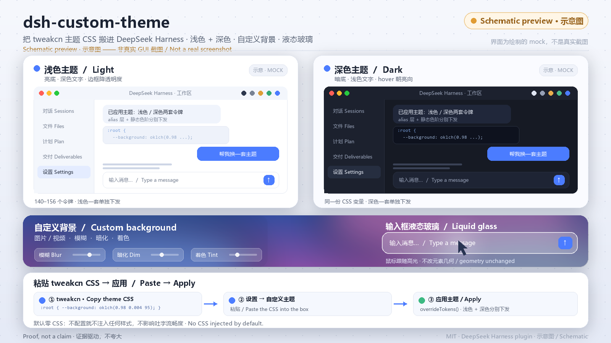

# dsh-custom-theme

**Bring [tweakcn](https://tweakcn.com) themes into [DeepSeek Harness](https://github.com/deepseek-ai/DeepSeek-Harness).**
Paste a theme's CSS, get both a light and a dark palette applied across the whole UI.
Ships with optional custom wallpaper (image / video, blur, dim, tint) and an
Apple-style liquid-glass composer with a pointer-following specular highlight.

[中文说明](README.zh-CN.md) · [Install with an AI agent](docs/ai-install.md)



> The image above is a **schematic illustration**, not a screenshot of the running app.

---

## What you get

| | |
| --- | --- |
| **Two palettes from one paste** | `:root { … }` → light, `:root.dark { … }` → dark. A single-palette theme gains a legible companion automatically. |
| **Whole-UI coverage** | 140–156 design tokens: alias layer, specific surfaces, focus rings, radii, fonts, and 38 static colour ramps. Light and dark are delivered separately. |
| **Paste-safety** | Only CSS custom-property *declarations* are read. Pasted content is never inserted as a stylesheet. `url()`, `@import`, `expression()`, `javascript:`, braces and semicolons are rejected. |
| **Custom wallpaper** | Image or video, `blur` / `dim` / `tint` sliders, optional local file (downscaled to 1920 px and re-encoded as JPEG before storage). |
| **Liquid glass** | Frosted composer with a white specular highlight that follows the pointer. The element itself never scales or transforms. |
| **Offline, no telemetry** | Everything runs in the renderer. No network requests, no analytics, no account. |

### A deliberate non-feature

The plugin **does not** try to change how fast the model's text appears. DSH assembles
`assistant/live-chunk` deltas into a string and hands the whole block to `MarkdownText`;
the only pacing in the client is a triple `requestAnimationFrame` flush. A client plugin
has no per-chunk event, and a `MutationObserver` only sees text *after* React commits it.
Rewriting the conversation renderer would drop the official Markdown, tool cards and
citation interactions, and break copy/paste.

What the plugin *does* guarantee is that it does not make it worse: with everything off
it injects **zero CSS, zero SVG filters and zero token overrides**. Glass and wallpaper
are strictly opt-in, so a fresh install adds no per-frame compositing work to a live
stream. An earlier revision enabled an SVG displacement filter by default; that was the
most likely cause of janky output in small text areas and has been removed.

---

## Install

### Requirements

- DeepSeek Harness with a CLI-managed profile (`web` by default). The **desktop** profile is
  owned by the Electron app and refuses CLI installs — see the note below.
- Node.js ≥ 22 for development / rebuilding `client.js`. **Running the plugin needs no
  build step**: the generated `client.js` is committed.

### Three commands

```bash
git clone https://github.com/cndoin/dsh-custom-theme.git "$HOME/.dsh/plugins/dsh-custom-theme"
dsh plugin --profile web add link:"$HOME/.dsh/plugins/dsh-custom-theme"
dsh plugin --profile web install
```

Then restart the host (`dsh web`) — the host half mounts only at process start.

Verify:

```bash
grep -A6 '"dsh"' "$HOME/.dsh/profiles/web/package.json"
# dsh-custom-theme must appear in dsh.profile.bundles
```

> **`declares no dsh.bundle`?** pnpm does not always create a root link for `link:`
> dependencies. Create it yourself — a junction on Windows
> (`New-Item -ItemType Junction -Path "$HOME\.dsh\profiles\web\node_modules\dsh-custom-theme" -Target <clone>`),
> a symlink elsewhere — and declare `"dsh-custom-theme": "link:<abs path>"` under
> `dependencies` in the profile's `package.json`. Then re-run `dsh plugin --profile web install`.

### Desktop profile

The `desktop` profile is managed by the Electron application, not the CLI. If you installed
through the app's plugin manager, the plugin is already active and the `client.js` change
is visible after a reload (`Ctrl+R`) or a Harness restart. State lives in the browser's
`localStorage` under `dsh-custom-theme/v1`, so it persists across reloads but is not synced
between machines.

### Uninstall

```bash
dsh plugin --profile web remove dsh-custom-theme
```

---

## Use

**Settings → Custom theme** (registered into `settings.section` with `order: 32`).

1. Pick a theme at [tweakcn.com](https://tweakcn.com) (or build your own), click **Copy theme**.
2. Paste it into the box and click **Apply theme**.
3. **Restore default** puts everything back.

Three built-in presets (Claude / Amethyst Haze / T3 Chat) fill the paste box so you can
see the format first; they are not applied until you click Apply.

The wallpaper and glass card is independent of the theme paste; changes are instant and do
not require Apply. Both are **off by default** — enable them only if you want them.

> **Nothing shows up?** The bottom of the card has a **Run status** JSON block. It reports
> the switch states, URL validation result, CSS length, whether the DOM layer was created,
> token count, and whether the browser supports `backdrop-filter`. Copy it into an issue.

---

## Compatibility

The parser is exercised against a matrix of real generator outputs, not just the happy path.

| Input | Example |
| --- | --- |
| tweakcn v4 `:root` / `.dark` | `--background: oklch(1 0 0);` |
| tweakcn v3 / legacy HSL triplets | `--primary: 221 83% 53%;` → wrapped as `hsl(...)` |
| `oklch()` / `hsl()` / `rgb()` / 3-, 4-, 6-, 8-digit hex | including negative hue and alpha |
| `:root`, `:host`, `html`, `body`, `[data-theme="dark"]`, `.dark`, `:is(.dark)`, grouped `:root, .dark` | plus `:not(.dark)` / `:root:not(.dark)` negation |
| `@theme inline` font stacks (v0 exports) | real font lists preserved |
| shadcn registry item JSON, registry index JSON, bare `{ light, dark }` / `cssVars` | fenced JSON, BOM, prose-wrapped JSON, top-level arrays |
| Markdown fences, surrounding prose, BOM, CRLF | stripped before parsing |
| Single-palette community exports | companion dark/light scheme derived from luminance |

`npm test` runs 97 unit tests plus six compatibility scripts:

```
ALL FORMATS PASS                 0 case(s) need attention
ALL 10 GENERATOR OUTPUTS PASS   PLACEHOLDER FORMAT PASSES
AUDIT FINDINGS PASS             ALL 42 PRESETS PASS
```

The method behind each claim — which shipped DSH bundles were read, which selectors are
stable, what the headless checks actually prove — is in [docs/evidence.md](docs/evidence.md).

---

## How it works

### One override layer

`ctx.theme.overrideTokens('dsh-custom-theme', tokens)` is called with a **fixed source id**,
so re-applying replaces the layer instead of stacking. `ThemePresenter` writes each token
with `body.style.setProperty(name, value)`. The plugin therefore never emits a token whose
value is `var(<same name>)` — that would be a self-referencing invalid value.

### Wallpaper isolation

Only two **shell** tokens may become translucent: `--dsw-alias-bg-base` and
`--dsw-specific-sidebar-fill`. `--dsw-alias-bg-layer-1` / `-2`, `--dsw-alias-bg-overlay`
and `--dsw-specific-input-major` are used by code blocks, trajectory tables, message cards
and popovers (`ui-trajectory` alone references layer-1 28 times); they are never touched.
When no custom theme is applied, **no shell token is overridden at all** — hardcoded
fallbacks would otherwise clobber DSH's currently active built-in theme.

### Glass without breaking the composer

The glass rule targets the stable `[data-composer-card]` attribute only. It contains:

- no `transform` / `scale` (an earlier revision squeezed the page — the element's geometry
  is now untouched),
- no SVG `filter: url(...)` on the composer (a filter creates a new containing block and
  would misplace `@`-mention / attachment / emoji popovers, and clip overflow),
- no `isolation`, no child selectors, no pseudo-elements,
- no `!important` on `background-color` / `border-radius` / `border` (DSH's focus-visible
  and error states stay intact); specificity comes from
  `:not(:focus-within):not([data-error])` instead.

Pointer tracking is deliberately quiet: a resident low-frequency `pointerover` /
`pointerout` pair, with `pointermove` attached only while the pointer is over the card;
one `requestAnimationFrame` with latest-wins coalescing; values are compared before being
written; all listeners are `passive`; nothing calls `preventDefault` / `stopPropagation`.
`(hover: hover) and (pointer: fine)`, `prefers-reduced-motion` and `pointer: coarse` gate it.

### Degradation

`@supports not (backdrop-filter)` → solid colour; `prefers-reduced-transparency` → fully
opaque; `prefers-reduced-motion` → static highlight and paused video (also paused when the
page is hidden); `forced-colors` → system colours; performance mode caps blur at 8 px.
Video is always `autoplay muted loop playsinline`.

### Windows caption strip stays draggable

On Windows DSH uses `titleBarStyle: "hidden"` and paints its draggable caption strip as
`[data-windows-titlebar] .frame:before` — a 40 px element with
`-webkit-app-region: drag` whose background is `var(--dsw-specific-sidebar-fill)`. That
strip is what makes the top bar draggable and gives double-click maximize/restore.

Enabling a wallpaper makes that token translucent so the image shows through, which also
makes the caption strip transparent. On an acrylic / transparent Electron window the hit
test then stops treating the strip as part of the window: **dragging the top bar and
double-clicking to maximize both stop working** (observed on DSH 0.2.2-rc.1, Windows).

The fix repaints **only** that pseudo-element with the theme's original opaque colour
(`html[data-windows-titlebar] [class*="frame"]:before`), using a stable attribute + class
substring so a hashed-class rename does not break it. Every other surface keeps its
translucent wallpaper look, and the rule is emitted only while a wallpaper is actually
enabled — so the zero-CSS-by-default guarantee is untouched. Regression test:
`tests/backdrop.test.mjs`.

---

## Architecture

```
src/core.js             Pure theme parsing / mapping. No DOM, no imports. Inlined.
src/backdrop.js         Pure wallpaper + glass CSS generation. Inlined.
src/client.template.js  Settings page, controller, pointer tracking. Inlined.
src/dictionaries.js     zh / en locale strings. Inlined.
src/presets.json        Three built-in theme examples. Inlined.
scripts/build.mjs       Concatenates the above into client.js (no bundler, no deps).
client.js               Generated browser half — committed, no build step at install time.
index.js                Host half: a no-op entry (state lives in the browser).
cordis.patch.yml        Inserts only this plugin's own entry.
tests/                  97 unit tests, including a VM end-to-end DOM injection check.
tests/fixtures/         Self-contained fact snapshots: 8 theme exports, the 42
                        tweakcn presets, the DSH token-name / declaration sheets.
scripts/                Compatibility / adversarial / generator-parity probes.
docs/                   AI install runbook and the evidence/method notes.
assets/                 Schematic preview image.
```

Everything the test suite needs is committed: a plain `git clone` can run `npm test`
with no network access and no extra research checkout. The fixture snapshots are
**fact data** (raw CSS variable values and token names), not bundled upstream source
code — see `tests/fixtures/README.md`.

`client.js` is generated. Do not edit it by hand — `tests/core.test.mjs` re-builds it
**read-only, in memory** and compares byte-for-byte with the sources, so a hand edit fails
the suite without touching the working tree.

The browser half is a `window.__ModuleLoader__.load({ id, factory })` closure factory;
React is injected by the factory parameter, and the theme service comes from Cordis
dependency injection (`inject: ['slots', 'locale', 'theme']`).

---

## Development

```bash
node scripts/build.mjs     # regenerate client.js
npm test                   # 97 unit tests + 6 compatibility scripts
npm run check              # build + node --check + full test
```

Adding a theme format? Add a case to `scripts/format-matrix.mjs` and a regression test in
`tests/core.test.mjs`. Adding a token? Update `buildOverrides()` in `src/core.js` and re-run
`scripts/dump-mapping.mjs` to inspect the generated light/dark values.

---

## Known limitations

- Text **arrival rate** is owned by the model response and DSH's renderer; the plugin
  cannot smooth it (see *A deliberate non-feature* above).
- The wallpaper uses two translucent shell tokens. A few DSH components paint directly
  from static colour ramps; those stay opaque by design to keep code and tables readable.
- With glass enabled and no `!important`, a future DSH release could introduce a
  higher-specificity composer background rule that wins over the frosted layer. If that
  happens, the fix is a more specific selector, not an `!important`.
- The bundled `client.js` is verified by headless-Chrome CSS-rule checks and a VM DOM
  harness, not by a full visual pass over the live GUI.

---

## License

[MIT](LICENSE). The three bundled presets come from tweakcn (Apache-2.0); raw CSS variable
values are not a creative work and are included as format examples only.
