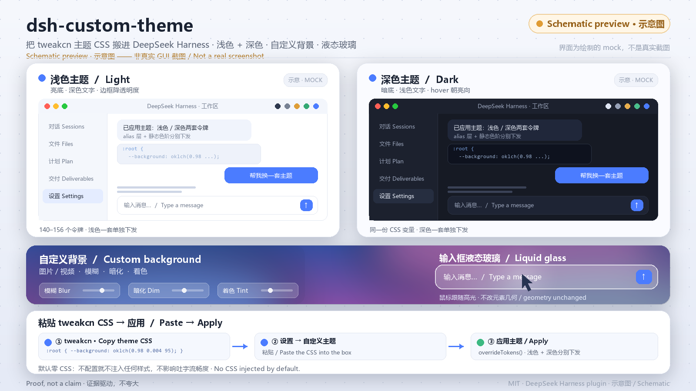

# dsh-custom-theme

**Bring [tweakcn](https://tweakcn.com) themes into [DeepSeek Harness](https://github.com/deepseek-ai/DeepSeek-Harness).**
Paste a theme's CSS, get both a light and a dark palette applied across the whole UI.
Ships with optional custom wallpaper (image / video, blur, dim, tint) and an
Apple-style liquid-glass composer with a pointer-following specular highlight.

[中文说明](README.zh-CN.md) · [Install with an AI agent](docs/ai-install.md)



> The image above is a **schematic illustration**, not a screenshot of the running app.

---

## What you get

| | |
| --- | --- |
| **Two palettes from one paste** | `:root { … }` → light, `:root.dark { … }` → dark. A single-palette theme gains a legible companion automatically. |
| **Whole-UI coverage** | 155–171 design tokens per theme: alias layer, specific surfaces, focus rings, radii, fonts, and 38 static colour ramps. Light and dark are delivered separately. |
| **Paste-safety** | Only CSS custom-property *declarations* are read. Pasted content is never inserted as a stylesheet. `url()`, `@import`, `expression()`, `javascript:`, braces and semicolons are rejected. |
| **Custom wallpaper** | Image or video, `blur` / `dim` / `tint` sliders, optional local file (downscaled to 1920 px and re-encoded as JPEG before storage). |
| **Liquid glass** | Frosted composer with a white specular highlight that follows the pointer. The element itself never scales or transforms. |
| **Interaction effects** | Optional fade-in for new reply text, button feedback and glass that stays visible while typing. |
| **Offline, no telemetry** | Everything runs in the renderer. No network requests, no analytics, no account. |

### Streaming and interaction effects

Enable **Streaming and interaction effects** in the plugin settings. Newly committed
reply text fades in over about 145 ms. DSH keeps control of delivery timing and Markdown.
The effect paints text ranges in place, preserving selection and copy, and pauses when
the page is hidden or the system requests reduced motion. It requires browser support
for CSS Custom Highlights. Wallpaper, glass and interaction effects start off.

---

## Install

### Requirements

- DeepSeek Harness with a CLI-managed profile (`web` by default). The **desktop** profile is
  owned by the Electron app: the `dsh` CLI refuses to write it, so install there through the
  app's own plugin manager instead — see the note below.
- Node.js ≥ 22 for development / rebuilding `client.js`. **Running the plugin needs no
  build step**: the generated `client.js` is committed.
- **Compatibility (verified 2026-11-19 against the installed build and the `nightly` feed):
  DSH 0.2.2-rc.5.** Every runtime contract was re-checked inside the current `app.asar`: the
  `__ModuleLoader__.load({ id, factory })` closure factory, `ctx.theme.overrideTokens` (still
  requires a `{ light, dark }` pair), `ctx.locale.register` / `bind`,
  `ctx.slots.inject('settings.section')` (still declared by the `sidebar.settings` factory as
  `{ kind: 'list', scope: 'root' }`, with a function `label` and `order` sort), the generator
  form of `ctx.effect` that `slots.inject` relies on, and the stable
  `body[data-ds-dark-theme]` / `html[data-windows-titlebar]` / `[data-composer-card]` /
  `[data-window-drag]` selectors.
  Two things did change, and this release follows them: **50 tokens were added** to the theme
  sheet (17 now mapped here) and macOS Desktop stopped granting a **global window-drag
  exclusion** to arbitrary content (see the `window-drag-regions` note below).

### Three commands

```bash
git clone https://github.com/cndoin/dsh-custom-theme.git "$HOME/.dsh/plugins/dsh-custom-theme"
dsh plugin --profile web add link:"$HOME/.dsh/plugins/dsh-custom-theme"
dsh plugin --profile web install
```

Then restart the host (`dsh web`) — the host half mounts only at process start.

Verify:

```bash
grep -A6 '"dsh"' "$HOME/.dsh/profiles/web/package.json"
# dsh-custom-theme must appear in dsh.profile.bundles
```

> **`declares no dsh.bundle`?** pnpm does not always create a root link for `link:`
> dependencies. Create it yourself — a junction on Windows
> (`New-Item -ItemType Junction -Path "$HOME\.dsh\profiles\web\node_modules\dsh-custom-theme" -Target <clone>`),
> a symlink elsewhere — and declare `"dsh-custom-theme": "link:<abs path>"` under
> `dependencies` in the profile's `package.json`. Then re-run `dsh plugin --profile web install`.

### Desktop profile

The `desktop` profile is managed by the Electron application, not the CLI. If you installed
through the app's plugin manager, the plugin is already active and the `client.js` change
is visible after a reload (`Ctrl+R`) or a Harness restart. State lives in the browser's
`localStorage` under `dsh-custom-theme/v1`, so it persists across reloads but is not synced
between machines.

### Uninstall

```bash
dsh plugin --profile web remove dsh-custom-theme
```

---

## Use

**Settings → Custom theme** (registered into `settings.section` with `order: 32`).

1. Pick a theme at [tweakcn.com](https://tweakcn.com) (or build your own), click **Copy theme**.
2. Paste it into the box and click **Apply theme**.
3. **Restore default** puts everything back.

Three built-in presets (Claude / Amethyst Haze / T3 Chat) fill the paste box so you can
see the format first; they are not applied until you click Apply.

The wallpaper and glass card is independent of the theme paste; changes are instant and do
not require Apply. Both are **off by default** — enable them only if you want them.

Every numeric parameter now has **both** a discrete-stop dropdown and its original slider
(the two stay in sync); dragging the slider flips the dropdown to "Custom". The glass card
also offers three one-click quality presets: **Smooth** (recommended on low-end machines:
one shallow `blur()` and a static surface), **Balanced** (pointer-following light and press
ripples), and **Fine** (more pronounced light and depth).

**Fonts are off by default.** tweakcn's `--font-sans` is usually Latin-only (e.g.
`Geist, sans-serif`); enabling takeover wrote it INLINE on `<body>` through
`overrideTokens`, beating DSH's built-in `PingFang SC` / `Microsoft YaHei` stack and the
user's own font choice, so CJK text fell back to a system font with synthesized bold. An
existing saved `fonts:true` profile is migrated to `false` on load. Opt in explicitly in
*Mapping options* only if you really want a theme font.

> **Nothing shows up?** The bottom of the card has a **Run status** JSON block. It reports
> the switch states, URL validation result, CSS length, whether the DOM layer was created,
> token count, and whether the browser supports `backdrop-filter`. Copy it into an issue.

---

## Compatibility

The parser is exercised against a matrix of real generator outputs, not just the happy path.

| Input | Example |
| --- | --- |
| tweakcn v4 `:root` / `.dark` | `--background: oklch(1 0 0);` |
| tweakcn v3 / legacy HSL triplets | `--primary: 221 83% 53%;` → wrapped as `hsl(...)` |
| `oklch()` / `hsl()` / `rgb()` / 3-, 4-, 6-, 8-digit hex | including negative hue and alpha |
| `:root`, `:host`, `html`, `body`, `[data-theme="dark"]`, `.dark`, `:is(.dark)`, grouped `:root, .dark` | plus `:not(.dark)` / `:root:not(.dark)` negation |
| `@theme inline` font stacks (v0 exports) | real font lists preserved |
| shadcn registry item JSON, registry index JSON, bare `{ light, dark }` / `cssVars` | fenced JSON, BOM, prose-wrapped JSON, top-level arrays |
| Markdown fences, surrounding prose, BOM, CRLF | stripped before parsing |
| Single-palette community exports | companion dark/light scheme derived from luminance |

`npm test` runs 108 unit tests plus six compatibility scripts:

```
ALL FORMATS PASS                 0 case(s) need attention
ALL 10 GENERATOR OUTPUTS PASS   PLACEHOLDER FORMAT PASSES
AUDIT FINDINGS PASS             ALL 42 PRESETS PASS
```

The method behind each claim — which shipped DSH bundles were read, which selectors are
stable, what the headless checks actually prove — is in [docs/evidence.md](docs/evidence.md).

---

## How it works

### One override layer

`ctx.theme.overrideTokens('dsh-custom-theme', tokens)` is called with a **fixed source id**,
so re-applying replaces the layer instead of stacking. `ThemePresenter` writes each token
with `body.style.setProperty(name, value)`. The plugin therefore never emits a token whose
value is `var(<same name>)` — that would be a self-referencing invalid value.

### Wallpaper isolation

Only two **shell** tokens may become translucent: `--dsw-alias-bg-base` and
`--dsw-specific-sidebar-fill`. `--dsw-alias-bg-layer-1` / `-2`, `--dsw-alias-bg-overlay`
and `--dsw-specific-input-major` are used by code blocks, trajectory tables, message cards
and popovers (`ui-trajectory` alone references layer-1 28 times); they are never touched.
When no custom theme is applied, **no shell token is overridden at all** — hardcoded
fallbacks would otherwise clobber DSH's currently active built-in theme.

### Glass without breaking the composer

The `[data-composer-card]` keeps its geometry and native focus styling. A stationary
pseudo-element paints the frosted backing and rim. A separate inset pseudo-element paints
the moving highlight and expands a press ripple from the pointer. The workspace picker
keeps its native dashed outline. The two decorative layers ignore pointer events.

Pointer tracking is deliberately quiet: a resident low-frequency `pointerover` /
`pointerout` pair, with `pointermove` attached only while the pointer is over the card;
one `requestAnimationFrame` with latest-wins coalescing; values are compared before being
written; all listeners are `passive`; nothing calls `preventDefault` / `stopPropagation`.
Mouse and pen events drive hover lighting. A primary press adds the brief ripple, including
on touch screens. The system reduced-motion preference disables both effects.

Interaction references are [Apple's Liquid Glass documentation](https://developer.apple.com/documentation/SwiftUI/Applying-Liquid-Glass-to-custom-views),
[SmoothUI Glass Card](https://smoothui.dev/docs/components/glass-card), and
[simple-liquid-glass](https://github.com/lucaperullo/simple-liquid-glass).

### Degradation

`@supports not (backdrop-filter)` → solid colour; `prefers-reduced-transparency` → fully
opaque; `prefers-reduced-motion` → static highlight and paused video (also paused when the
page is hidden); `forced-colors` → system colours; performance mode caps blur at 8 px.
Video is always `autoplay muted loop playsinline`.

### Windows caption strip stays draggable

On Windows DSH uses `titleBarStyle: "hidden"` and paints its draggable caption strip as
`[data-windows-titlebar] .frame:before` — a 40 px element with
`-webkit-app-region: drag` whose background is `var(--dsw-specific-sidebar-fill)`. That
strip is what makes the top bar draggable and gives double-click maximize/restore.

Enabling a wallpaper makes that token translucent so the image shows through, which also
makes the caption strip transparent. On an acrylic / transparent Electron window the hit
test then stops treating the strip as part of the window: **dragging the top bar and
double-clicking to maximize both stop working** (observed on Windows, DSH 0.2.2-rc.5).

The fix repaints **only** that pseudo-element with the theme's original opaque colour
(`html[data-windows-titlebar] [class*="frame"]:before`), using a stable attribute + class
substring so a hashed-class rename does not break it. Every other surface keeps its
translucent wallpaper look, and the rule is emitted only while a wallpaper is actually
enabled — so the zero-CSS-by-default guarantee is untouched. Regression test:
`tests/backdrop.test.mjs`.

### Explicit window regions (macOS)

DSH 0.2.2-rc.2 changed how macOS Desktop computes the window drag region (upgrade guide
`window-drag-regions`): it no longer grants a global `no-drag` exclusion to controls and
ARIA roles anywhere in the page. Only controls inside a `data-window-drag` row or a
`data-window-drag-controls` scope get one automatically, so **a custom overlay that covers a
header must now declare its own region**.

The wallpaper layer is exactly such an overlay: it is mounted `position: fixed; inset: 0`
across the whole window. The client half therefore sets `data-window-drag-exclude` on that
element and the stylesheet keeps its children out of any inherited drag region. The layer is
already `pointer-events: none`, so this affects only the region computation and never click
behaviour. scoped to `[data-platform="darwin"]`; Windows and plain Web are untouched.

---

## Architecture

```
src/core.js             Pure theme parsing / mapping. No DOM, no imports. Inlined.
src/backdrop.js         Pure wallpaper + glass CSS generation. Inlined.
src/client.template.js  Settings page, controller, pointer tracking. Inlined.
src/dictionaries.js     zh / en locale strings. Inlined.
src/presets.json        Three built-in theme examples. Inlined.
scripts/build.mjs       Concatenates the above into client.js (no bundler, no deps).
client.js               Generated browser half — committed, no build step at install time.
index.js                Host half: a no-op entry (state lives in the browser).
cordis.patch.yml        Inserts only this plugin's own entry.
tests/                  108 unit tests, including a VM end-to-end DOM injection check.
tests/fixtures/         Self-contained fact snapshots: 8 theme exports, the 42
                        tweakcn presets, the DSH token-name / declaration sheets.
scripts/                Compatibility / adversarial / generator-parity probes.
docs/                   AI install runbook and the evidence/method notes.
assets/                 Schematic preview image.
```

Everything the test suite needs is committed: a plain `git clone` can run `npm test`
with no network access and no extra research checkout. The fixture snapshots are
**fact data** (raw CSS variable values and token names), not bundled upstream source
code — see `tests/fixtures/README.md`.

`client.js` is generated. Do not edit it by hand — `tests/core.test.mjs` re-builds it
**read-only, in memory** and compares byte-for-byte with the sources, so a hand edit fails
the suite without touching the working tree.

The browser half is a `window.__ModuleLoader__.load({ id, factory })` closure factory;
React is injected by the factory parameter, and the theme service comes from Cordis
dependency injection (`inject: ['slots', 'locale', 'theme']`).

---

## Development

```bash
node scripts/build.mjs     # regenerate client.js
npm test                   # 108 unit tests + 6 compatibility scripts
npm run check              # build + node --check + full test
```

Adding a theme format? Add a case to `scripts/format-matrix.mjs` and a regression test in
`tests/core.test.mjs`. Adding a token? Update `buildOverrides()` in `src/core.js` and re-run
`scripts/dump-mapping.mjs` to inspect the generated light/dark values.

---

## Known limitations

- Text **arrival rate** is owned by the model response and DSH's renderer; the plugin
  cannot smooth it (see *A deliberate non-feature* above).
- The wallpaper uses two translucent shell tokens. A few DSH components paint directly
  from static colour ramps; those stay opaque by design to keep code and tables readable.
- With glass enabled and no `!important`, a future DSH release could introduce a
  higher-specificity composer background rule that wins over the frosted layer. If that
  happens, the fix is a more specific selector, not an `!important`.
- The bundled `client.js` is verified by headless-Chrome CSS-rule checks and a VM DOM
  harness, not by a full visual pass over the live GUI.

---

## License

[MIT](LICENSE). The three bundled presets come from tweakcn (Apache-2.0); raw CSS variable
values are not a creative work and are included as format examples only.
