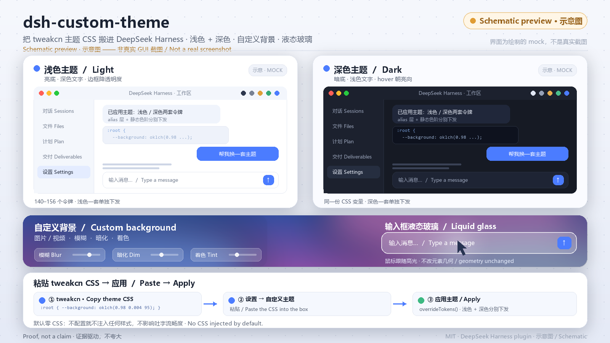

# 自定义主题（dsh-custom-theme）

[English](README.md)

把 [tweakcn](https://tweakcn.com) 的主题 CSS 搬进 DeepSeek Harness（DSH）：在设置里粘贴一段主题 CSS，
界面配色按**浅色 + 深色两套**分别下发。同一个插件还提供**自定义背景**（图片 / 视频 + 模糊 / 暗化 / 着色）
与**输入框液态玻璃**（可调透明度、模糊、饱和度，以及鼠标跟随的边缘高光）。



> 上图是示意图（Schematic preview），界面为绘制的 mock，不是真实 GUI 截图。

| 模块 | 说明 |
| --- | --- |
| **主题** | 只读 CSS 变量声明，映射到 Harness 设计令牌；浅色、深色各一套 |
| **背景** | 图片 / 视频，可调模糊、暗化、着色；本地图片缩到 1920px 转 JPEG 后保存 |
| **液态玻璃** | 挂在输入框上的半透明层 + 鼠标跟随高光；**默认关闭** |
| **状态 / 开销** | 只存在浏览器 `localStorage`，不跨机器同步；**默认零 CSS**，不配置就不注入任何样式 |

---

## 安装

要求：有 CLI 管理的 profile（默认 `web`）。**`desktop` profile 归 Electron 应用独占，CLI 会拒绝写入，
不要往那里装。** Node.js ≥ 22.12.0（见 `package.json` 的 `engines`）。

> **版本兼容性（2026-11-11 核对）**：当前安装与 nightly 服务器均为 **DSH 0.2.2-rc.1**，
> 与插件开发时基于的版本一致，并没有升级（11/9 那次「更新」其实是同版本重新下载，
> 因文件被占用 `MoveFileExW / Windows error 32` 失败，未替换任何文件）。已逐一核对当前
> `app.asar` 内部：`__ModuleLoader__.load({id, factory})`、`ctx.theme.overrideTokens`、
> `ctx.locale`、`ctx.slots.inject('settings.section')`、注入的三个客户端包，以及
> `body[data-ds-dark-theme]` / `html[data-windows-titlebar]` / `[data-composer-card]` /
> `[data-window-drag]` 等稳定选择器全部存在且未改名 —— **完全兼容，无需为升级改动**。

三条命令：

```bash
git clone https://github.com/cndoin/dsh-custom-theme.git "$HOME/.dsh/plugins/dsh-custom-theme"
dsh plugin --profile web add link:"$HOME/.dsh/plugins/dsh-custom-theme"
dsh plugin --profile web install
```

然后重启宿主（`dsh web`）—— bundle 在宿主进程启动时挂载。

```bash
grep -A6 '"dsh"' "$HOME/.dsh/profiles/web/package.json"
# dsh-custom-theme 必须出现在 dsh.profile.bundles 里
```

> **报「找不到插件」或 `declares no dsh.bundle`？** pnpm 不一定会为 `link:` 依赖建根链接。自己补一个：
> Windows 用 junction
> （`New-Item -ItemType Junction -Path "$HOME\.dsh\profiles\web\node_modules\dsh-custom-theme" -Target <克隆目录>`），
> 其他系统用软链；并在 profile 的 `package.json` 的 `dependencies` 里写上
> `"dsh-custom-theme": "link:<绝对路径>"`，再跑一次 `dsh plugin --profile web install`。

卸载：`dsh plugin --profile web remove dsh-custom-theme`。

---

## 使用

1. 打开 **设置 → 自定义主题**。
2. 到 [tweakcn.com](https://tweakcn.com) 挑一套主题，点 **Copy theme CSS** 复制。
3. 粘贴进输入框，点 **应用主题**；想换回来点 **恢复默认**。
4. 预设下拉内置三套（Claude / Amethyst Haze / T3 Chat）。选中只填进输入框，仍需点「应用主题」才生效 ——
   方便先看清格式长什么样。

**背景与液态玻璃**是两个相互独立的开关，改完即时生效，不用点「应用主题」：只开玻璃不开背景也能用，
反之亦然。每个参数都同时提供**下拉选档**和**滑块拖动**（两者保留、实时联动）：选档给一个精确值，
拖动滑块则自动切到「自定义」。玻璃另有三档一键预设：**流畅（推荐，低配不卡）/ 均衡 / 精细**，
卡顿优先选「流畅」——单层浅模糊、关掉折射、关闭指针跟随高光，均衡档还会把重绘限制在约 30fps。
背景模糊 / 暗化 / 着色以及玻璃透明度 / 模糊 / 饱和度 / 圆角 / 边缘高光 / 阴影 / 折射都可调。

**字体接管默认关闭**：tweakcn 的 `--font-sans` 通常只有拉丁字体（如 `Geist, sans-serif`），
没有中文字体。以前默认开启时，插件会把它内联写到 `<body>`，顶掉 DSH 内置含「苹方 / 微软雅黑」的字体栈
并绕过你在设置里选的字体，中文回退到系统字体、再叠加伪粗体，看起来就「变厚、发糊、没法用」。
现在默认不动 DSH 的字体栈，旧配置里的开启状态也会在加载时自动改回关闭；确实需要主题字体的，
可在「映射选项」里手动打开（并建议自行为字体栈补上中文字体）。

> **默认零 CSS**：不配置就不注入任何样式 —— 不挂 `backdrop-filter`、不挂 SVG 折射滤镜、不覆盖任何背景令牌。
> 在你手动开启背景 / 玻璃之前，插件不会给流式输出增加一帧重绘。文字出现的节奏由 DSH 自身的增量提交决定，
> 纯 client 插件拿不到 chunk 流，也不改会话内容。

看不到效果时，卡片底部的「运行状态」JSON 会列出开关状态、地址校验、CSS 长度、DOM 层是否创建、
令牌数与浏览器是否支持 `backdrop-filter` —— 直接复制即可定位断在哪一步。

---

## 兼容性矩阵（摘要）

| 来源 | 导出形式 | 处理方式 |
| --- | --- | --- |
| tweakcn v4 默认 | oklch 的 `:root` / `.dark` | 按源码顺序合并声明块 |
| tweakcn v3 / 旧版 | 裸 HSL 三元组、`hsl()`、hex、`rgb()`（含逗号式）、`@layer base` 包裹（含双 `@layer`） | 包装三元组；递归下降 + 分号断句，缩进无关 |
| shadcn registry item JSON | `cssVars.theme/light/dark` | JSON 别名映射（`letter-spacing` / `shadow-offset-x` 等） |
| `registry.json` 索引 | `items[]` 数组 | 读取条目 |
| v0.dev 导出 | `@theme inline` 位于 `:root` 之前，含额外 `@import` | 保留非自引用字体字面量，其余整块丢弃 |
| 社区导出 / 导入框 | 多格式混排、注释内夹声明、BOM、CRLF、markdown 栅栏、无末尾分号 | 先剥注释与栅栏，再提取声明 |
| 单套配色主题 | `.dark` 常是 `:root` 的副本 | 比较 32 个颜色变量，差异 < 10% 判为单套，自动派生另一套（可关） |

### 用证据说话 / Proof, not a claim

兼容性由可复跑的脚本验证，不是声明：`generator-parity.mjs` 按 tweakcn 源码逐字重建
`generateThemeCode()` 的 v3 / v4 分支与 `colorFormatter()` 的 4 种颜色格式（**10 种真实导出**）；
`format-matrix.mjs` 覆盖 18 种写法；`adversarial-probe.mjs` 覆盖 42 个对抗用例
（`:root:not(.dark)`、`:is(.dark)`、CSS 嵌套 `&`、`!important`、负 hue 裸三元组等）；
`audit-findings.mjs` 对应上游源码审计发现；`preset-sweep.mjs` 跑 42 套官方内置主题。

---

## 技术要点（摘要）

1. **安全解析**：只读取 CSS 变量声明；选择器、`@apply`、`@import`、`url()`、`@theme inline` 自引用块一律忽略 ——
   **粘贴的文本从不作为样式表插入页面**。用户 URL 先校验再进 CSS：拒绝 `javascript:`、`file:`、
   SVG data URL、含引号 / 反斜杠 / 括号的字符串；栅格 data URL ≤ 1.5 MB；视频只接受链接。
2. **`overrideTokens` 单层**：解析结果通过 `ctx.theme.overrideTokens()` 叠加一层覆盖层，浅色与深色分别下发。
3. **只改 2 个壳层令牌**：背景只让 `--dsw-alias-bg-base`、`--dsw-specific-sidebar-fill` 变半透明，
   代码块 / 轨迹表 / 消息卡片使用的 `--dsw-alias-bg-layer-1/-2` 一律不动；无自定义主题时一个令牌都不覆盖。
   部分面板直接取色的静态色阶（38 档）按页面色与墨色在两端插值重建，不是只改 alias 层。
4. **稳定 `data-*` 选择器**：玻璃挂在 `[data-composer-card]`（DSH `InputBar` 的稳定属性），不依赖哈希类名。
5. **玻璃不动元素几何**：输入框没有 `transform` / `scale`；只有一层高光与扫光跟随指针，
   弹性位移夹紧到 6px 以内。`pointermove` 仅在指针进入时挂载、离开即卸；rAF latest-wins、`passive: true`，
   并有 `(hover:hover) and (pointer:fine)`、`prefers-reduced-motion`、`pointer:coarse` 三重门控。
6. **降级齐全**：无 `backdrop-filter` 回退实色、降低透明度偏好时完全不透明、页面隐藏时暂停视频、
   性能模式把模糊压到 8px。

共接管 **140–156 个令牌**（alias 约 110 + 静态色阶 38）。几个刻意保留的决定
（边框默认降透明度、近灰 `--destructive` 忽略、`--chart-3/-4` 需过色相窗口、hover 方向按模式分）
在英文 README 逐条说明。

---

## 开发

```bash
node scripts/build.mjs              # 从 src/ 生成 client.js
npm test                            # 97 项单测 + 全部兼容性脚本
node scripts/dump-mapping.mjs X.css # 打印某套主题的完整映射表（调试用）
```

`npm test` 依次跑 `tests/core.test.mjs`、`tests/backdrop.test.mjs`（含 VM 端到端 DOM 注入验证）、
`format-matrix.mjs`、`adversarial-probe.mjs`、`generator-parity.mjs`、`import-placeholder.mjs`、
`audit-findings.mjs`、`preset-sweep.mjs`；同时校验 `client.js` 与 `src/` 字节级一致、
内联 core 与 ESM 模块行为一致。`client.js` 是生成物，**别手改** —— 测试里有一项只读地在内存里重建
并与它逐字节比对，改歪了会直接红。`preset-sweep.mjs` 需要 tweakcn 的 `theme-presets.ts`，
单独 checkout 时会优雅跳过，不影响其余测试。浏览器半侧以
`window.__ModuleLoader__.load({ id, factory })` 注册，React 由工厂参数注入（不打包）；
Host 半侧（`index.js`）是空的，状态全在浏览器里。

---

## 许可

MIT。内置三套预设来自 tweakcn（Apache-2.0），CSS 变量值本身不构成创造性表达，此处仅作格式示例。

研究证据与方法见仓库内 `docs/`。
